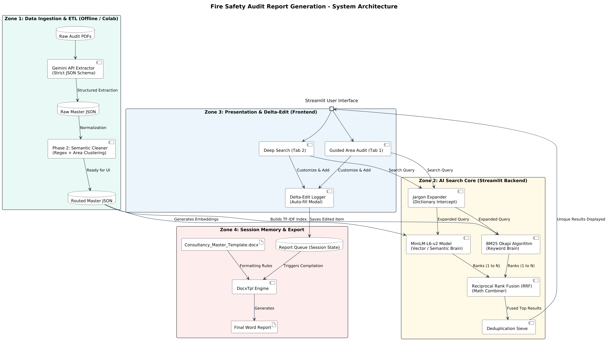
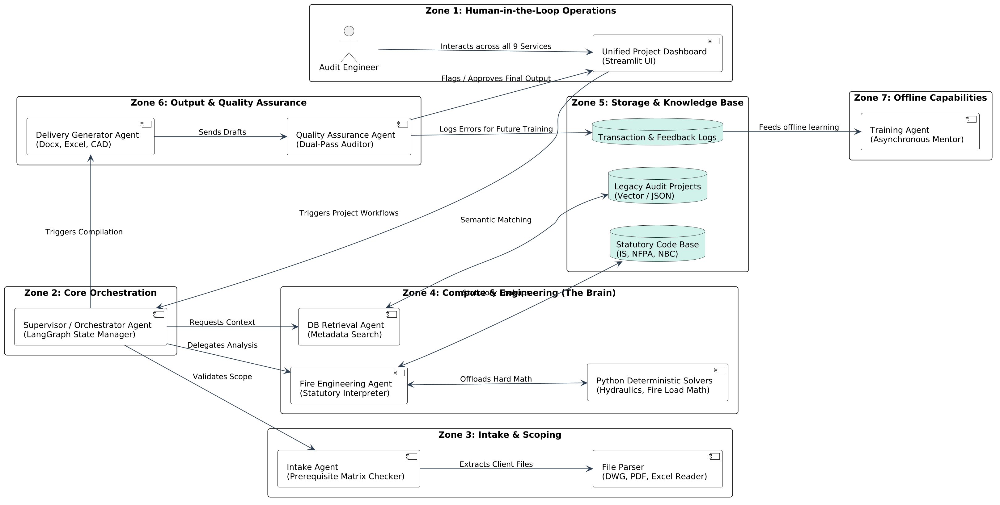

# Architecting Determinism in Fire Safety Engineering

**A First-Principles Blueprint for Eliminating Consulting Bottlenecks Through Hybrid Retrieval and Multi-Agent Automation**

[](https://www.python.org/)
[](https://docs.pydantic.dev/)
[](https://streamlit.io/)
[-2E7D32)](#empirical-retrieval-benchmarks)
[](LICENSE)

> **Executive Context:** Empirical workflow analysis across industrial Fire Safety Audits (FSAs) revealed that roughly **70%** of audit findings consist of recurring statutory compliance patterns. Yet trained engineers manually transcribe shorthand notes, look up Indian Standards / NFPA clauses, and format multi-column Word tables. Because fire safety carries severe life-safety and legal liability, standard probabilistic LLMs cannot be trusted to invent citations or compute hydraulic math. This repository documents—and provides the modular Python codebase for—an iterative systems engineering effort to **decouple probabilistic language parsing from deterministic compliance verification**.

---

## System Implementation & Validation Matrix

To maintain complete transparency between empirically benchmarked software and sprint-ready architectural designs, every module in this repository is explicitly categorized by maturity:

| System Module | Iteration | Current Status | Code Path | Validation Benchmark |
| :--- | :---: | :--- | :--- | :--- |
| **6-Stage Neo4j Hourglass GraphRAG** | Iteration 1 | **Archived PoC** | `src/iteration1_graphrag/` | Built & autopsied on legacy `.docx` reports; superseded due to historical subjectivity & vector blur |
| **Two-Phase Vision PDF Extractor** | Iteration 2 | **Implemented & Validated** | `src/iteration2_retrieval/pdf_extractor.py` | Compiled **958 structured nodes** across 8 multi-sector facilities with atomic disk checkpointing |
| **Deterministic Alias & Taxonomy Engine** | Iteration 2 | **Implemented & Validated** | `src/iteration2_retrieval/alias_engine.py` | Normalized **207 component variants** into 15 Master Categories & 5 Macro-Zones |
| **Two-Stage Hybrid RRF + Cross-Encoder** | Iteration 2 | **Implemented & Benchmarked** | `src/iteration2_retrieval/hybrid_rrf_engine.py` | Achieved **0.5921 MRR** (+4.18% lift) across a 130-query stratified gold-standard benchmark |
| **Streamlit Prototype & DocxTpl Exporter** | Iteration 2 | **Implemented & Validated** | `src/iteration2_retrieval/streamlit_app.py` | Dual-mode HITL search, Delta-Edit logger, Pillow photo cropping & live `.docx` matrix export |
| **XHTML-to-JSON Statutory Code Parser** | Iteration 3 | **Validated on Pilot Code** | `src/iteration3_mas_blueprint/xhtml_code_parser.py` | Parsed **IS 2190:2010** (`lxml`) with **97.87% word recovery** across 96 clauses & 13 unfolded tables |
| **5-Agent MAS Contracts & AST REPL Sandbox** | Iteration 3 | **Sprint-Ready Blueprint** | `src/iteration3_mas_blueprint/` | First-draft Pydantic contracts & `ast.NodeVisitor` sandbox with unit tests; **not yet tested on live production audits** |

---

## Architecture Overview

### Iteration 2: Metadata-Fenced Two-Stage Retrieval & Word Export


### Iteration 3: Proactive 5-Agent Multi-Agent System (7-Zone Blueprint)


---

## Architectural Evolution (3 Iterations)

Read the full 31-page engineering whitepaper and the 13-page QA Agent Verification & Validation SOP inside `docs/whitepaper/`:
* **[Architecting Determinism in Fire Safety Engineering (31-Page Whitepaper)](docs/whitepaper/Architecting_Determinism_FSA_Whitepaper.pdf)**
* **[QA Agent V&V Standard Operating Procedure (Contract-Driven Agentic V-Model)](docs/whitepaper/QA_Agent_SOP.pdf)**

1. **Iteration 1 — Observation-Anchored Hybrid GraphRAG (`src/iteration1_graphrag/`):**
   Attempted to model historical Word reports as a Neo4j Hourglass Knowledge Graph (`Area -> Component -> FailureMode -> MitigationRule -> Standard`). Testing exposed five failure modes: free-tier API rate walls, **The Ambiguity Trap** (conflicting historical risk ratings), **Vector Blur** (95% semantic similarity between legally opposite Butterfly and OS&Y Gate valves on pump suction), flat schema brittleness, and site-naming drift.
2. **Iteration 2 — Metadata-Fenced Two-Stage Hybrid RRF (`src/iteration2_retrieval/`):**
   Replaced unrestrained graph traversal with deterministic metadata barricades, a 25-acronym regex jargon expander, a `Complied` hard filter, parallel **Okapi BM25 + `all-MiniLM-L6-v2` Reciprocal Rank Fusion**, a **Cross-Encoder (`ms-marco-MiniLM-L-6-v2`)** reranker, a deduplication sieve, and a Human-in-the-Loop (HITL) Delta-Edit logger wired to `DocxTpl` Word export.
3. **Iteration 3 — Proactive 5-Agent MAS & Contract-Driven V-Model (`src/iteration3_mas_blueprint/` & `skills/`):**
   Diagnosed the **Missing Baseline Anomaly** (compliance cannot be deduced from an observation string without macro building boundaries like `H_max`, occupancy group, and ceiling geometry). Designed a 5-Agent MAS mirroring the universal 5-step consulting loop, backed by structured XHTML-to-JSON statutory codebases, progressive context disclosure (`SKILL.md`), **IEEE 1012 / ASME V&V 20** Pydantic contracts, and an isolated **`ast.NodeVisitor` Python REPL sandbox** enforcing the Zero-Inference Rule.

---

## Empirical Retrieval Benchmarks

Evaluated on **130 stratified, grammatically fragmented 4-to-7-word auditor queries** across 958 multi-sector observations (8 industrial and commercial facilities spanning NBC occupancy groups A-5, C-1, G-2, and G-3) using **Mean Reciprocal Rank (MRR)**:

| Retrieval Configuration | Stage | Top-1 Hits (of 130) | MRR Score | Key Observation |
| :--- | :---: | :---: | :---: | :--- |
| Pure Lexical (`Okapi BM25`) | Stage 1 | 48 | `0.5305` | Strong exact acronyms; blind to paraphrased shorthand |
| Pure Dense (`all-MiniLM-L6-v2`) | Stage 1 | 55 | `0.5559` | Handles shorthand; suffers semantic smudging on extinguisher agents |
| **Hybrid RRF (60% Vector / 40% BM25, `k=60`)** | Stage 1 | **57** | **`0.5684`** | Optimal parallel fusion ceiling across fragmented field queries |
| **Two-Stage Hybrid RRF + Cross-Encoder (`Top-20 -> Rerank`)** | **Stage 2** | **57** | **`0.5921`** | **+4.18% relative MRR lift** ("The Podium Effect": promotes Rank 10–15 hits to Ranks 2–3) |

<details>
<summary><strong>Click to expand full 11-row Stage 1 Hyperparameter Grid Search (0% to 100% Vector Weight)</strong></summary>

| Vector Weight | BM25 Weight | Top-1 Hits (of 130) | MRR Score |
| :---: | :---: | :---: | :---: |
| 0% | 100% | 48 | 0.5305 |
| 10% | 90% | 48 | 0.5311 |
| 20% | 80% | 47 | 0.5261 |
| 30% | 70% | 48 | 0.5348 |
| 40% | 60% | 48 | 0.5335 |
| 50% | 50% | 54 | 0.5556 |
| **60%** | **40%** | **57** | **0.5684** |
| 70% | 30% | 55 | 0.5642 |
| 80% | 20% | 54 | 0.5575 |
| 90% | 10% | 56 | 0.5610 |
| 100% | 0% | 55 | 0.5559 |

</details>

---

## Repository Directory Map

```text
architecting-determinism-fsa/
├── README.md                                        # Project overview, benchmarks & quickstart
├── LICENSE                                          # MIT License
├── requirements.txt                                 # Python dependencies
├── pytest.ini                                       # Pytest root configuration
├── .env.example                                     # Environment variable template (zero secrets)
├── docs/
│   ├── whitepaper/
│   │   ├── Architecting_Determinism_FSA_Whitepaper.pdf  # Final 31-page architectural whitepaper
│   │   └── QA_Agent_SOP.pdf                             # 13-page Contract-Driven Agentic V-Model SOP
│   └── diagrams/
│       ├── puml/                                    # Version-controlled anonymized PlantUML sources
│       └── *.png                                    # 300-DPI architecture, sequence & activity visuals
├── src/
│   ├── iteration1_graphrag/                         # Archived 6-stage Neo4j Hourglass PoC
│   │   ├── README.md
│   │   ├── step1_ingestion.py                       # Dynamic .docx table & italic-quote parser
│   │   ├── step2_gemini_structuring.py              # Pydantic LLM entity extraction w/ checkpointing
│   │   ├── step3_consensus_engine.py                # High-Water Mark & HITL quarantine resolver
│   │   ├── step4_taxonomy_compiler.py               # 5-Failure-Mode normalizer
│   │   ├── step5_neo4j_hourglass_injection.py       # Cypher MERGE Hourglass graph builder
│   │   └── step6_agentic_ui.py                      # GraphRAG semantic-router Streamlit prototype
│   ├── iteration2_retrieval/                        # Implemented & Benchmarked Retrieval Engine
│   │   ├── pdf_extractor.py                         # Two-phase Vision PDF extractor w/ atomic resume
│   │   ├── alias_engine.py                          # Regex cleaner, 5 Macro-Zones & 15 Master Categories
│   │   ├── hybrid_rrf_engine.py                     # 25-acronym expander, BM25+MiniLM RRF & Reranker
│   │   ├── evaluate_mrr.py                          # Stratified sampler, batch query gen & MRR grid search
│   │   ├── docxtpl_exporter.py                      # Pillow EXIF photo cropper & Section 6 .docx compiler
│   │   └── streamlit_app.py                         # Dual-mode UI, Delta-Edit logger & live Word export
│   └── iteration3_mas_blueprint/                    # Pilot Statutory Parser & Sprint-Ready MAS Contracts
│       ├── README.md
│       ├── xhtml_code_parser.py                     # Validated IS 2190 lxml parser + 5-Test QA Audit Suite
│       ├── intake_schemas.py                        # 21-doc RFI checklist, Facility Envelope & Micro-Zones
│       ├── qa_contracts.py                          # IEEE 1012 / ASME V&V 20 Pydantic data contracts
│       └── ast_repl_sandbox.py                      # Isolated ast.NodeVisitor math sandbox & V&V evaluator
├── skills/
│   └── fire-safety-auditor/                         # Progressive Context Disclosure (Claude Agent Skills)
│       ├── SKILL.md                                 # Level 1 YAML metadata + Level 2 reasoning instructions
│       └── references/statutory_thresholds.md       # Level 3 deterministic engineering trigger table
├── scripts/
│   └── build_blank_template.py                      # Generates logo-free Jinja2 Word template
├── templates/
│   └── consultancy_master_template.docx             # Anonymized Section 6 Word template
├── data/
│   ├── sample_routed_extract.json                   # Synthetic 10-row schema sample (100% anonymized)
│   └── sample_ground_truth.csv                      # Synthetic 6-query MRR smoke-test CSV
└── tests/
    ├── test_iteration1_and_2.py                     # Automated unit tests for Iterations 1 & 2
    └── test_iteration3_blueprint.py                 # Automated unit tests for XHTML parser, AST sandbox & V&V
```

---

## Local Quickstart & Reproduction

Every test and UI prototype below runs **100% locally with zero API keys required** using the anonymized synthetic dataset in `data/`.

### 1. Clone & Install Dependencies
```bash
git clone https://github.com/sudhanshusomani09/architecting-determinism-fsa.git
cd architecting-determinism-fsa

python -m venv .venv
# Windows PowerShell:
.venv\Scripts\Activate.ps1
# macOS / Linux:
# source .venv/bin/activate

pip install -r requirements.txt
```

### 2. Run the Automated Test Suite (All 3 Iterations)
```bash
pytest -v
```
This verifies:
* Iteration 1 High-Water Mark consensus & HITL quarantine routing.
* Iteration 2 Alias Engine taxonomy mapping, 25-acronym jargon expansion, deduplication sieve, and live `DocxTpl` `.docx` compilation.
* Iteration 3 XHTML `rowspan`/`colspan` table unfolding + 5-Test Audit Suite, 21-document Intake RFI triggers, AST code-injection blocking, and ASME V&V 20 verification vs. physics validation (`[FATAL ERROR]` vs. `[CONTEXTUAL FAILURE]` vs. `[OVERSIMPLIFICATION]`).

### 3. Run the Alias Engine & Two-Stage MRR Benchmark on Sample Data
```bash
# Run deterministic taxonomy normalization
python src/iteration2_retrieval/alias_engine.py \
  --input data/sample_routed_extract.json \
  --output data/sample_routed_verified.json

# Run Stage 1 Grid Search & Stage 2 Cross-Encoder MRR evaluation
python src/iteration2_retrieval/evaluate_mrr.py benchmark \
  --db data/sample_routed_extract.json \
  --queries data/sample_ground_truth.csv
```

### 4. Launch the Live Streamlit Prototype (with Real `.docx` Word Export)
```bash
streamlit run src/iteration2_retrieval/streamlit_app.py
```
Search shorthand queries such as `"missing foam pfe dg room"` or `"butterfly valve suction"`, customize a card via the **Delta-Edit** form, attach test images, and download a compiled Section 6 Word report from the sidebar.

### 5. Optional: LLM & Neo4j Pipelines
To run the cloud extraction (`pdf_extractor.py`) or Iteration 1 Neo4j scripts, copy `.env.example` to `.env` and populate your own credentials:
```bash
cp .env.example .env
```

---

## Data Privacy & Confidentiality Notice

To strictly uphold client Non-Disclosure Agreements (NDAs) and intellectual property law:
* **No proprietary client audit reports** or the full 958-row extracted industrial dataset are included in this repository.
* **No copyrighted statutory standards** (BIS Indian Standards, NBC 2016, NFPA, or OISD full texts) are redistributed; `xhtml_code_parser.py` is provided as a parser for locally licensed XHTML/EPUB copies.
* All sample observations in `data/sample_routed_extract.json` and the Word template in `templates/consultancy_master_template.docx` are 100% synthetic and logo-free.

---

## Enterprise Scaling Roadmap

* **Dual-Pillar Retrieval Upgrade (Target: `0.85+ MRR`):** Upgrade Stage 1 embeddings from 384-dim `all-MiniLM-L6-v2` to 1024-dim `BAAI/bge-large-en-v1.5`, upgrade Stage 2 reranking to `bge-reranker-v2-m3` / Cohere Rerank 3, add Hypothetical Document Embeddings (HyDE) for 5-word auditor queries, and expand the corpus from 958 to 5,000+ validated findings.
* **30-Day Iteration 3 MVP Deployment Sprint:** Convert remaining XHTML codebooks (NBC 2016 Part 4, IS 2189, IS 13039, IS 15105), wire the Orchestrator state machine to production LLM APIs, and stress-test end-to-end across 5 multi-sector audits.
* **Horizontal Scaling Across 9 Consulting Verticals:** Because the 5-Agent MAS mirrors the universal 5-step consulting loop, extending the platform to Electrical Safety Audits (ESA), Process Safety, or Construction Safety requires only swapping the JSON statutory codebook and Micro-Zone intake triggers.

---

## License & Author

Released under the **[MIT License](LICENSE)**.

**Sudhanshu Somani**
Mechanical & Fire Safety Systems Engineer | Deterministic AI & Engineering Automation
* GitHub: [@sudhanshusomani09](https://github.com/sudhanshusomani09)
* Whitepaper: [Architecting Determinism in Fire Safety Engineering (PDF)](docs/whitepaper/Architecting_Determinism_FSA_Whitepaper.pdf)
